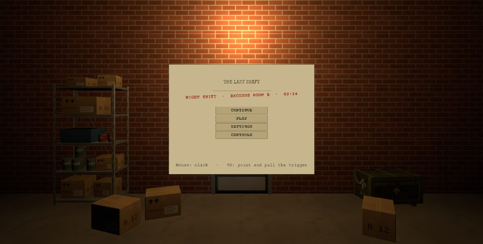
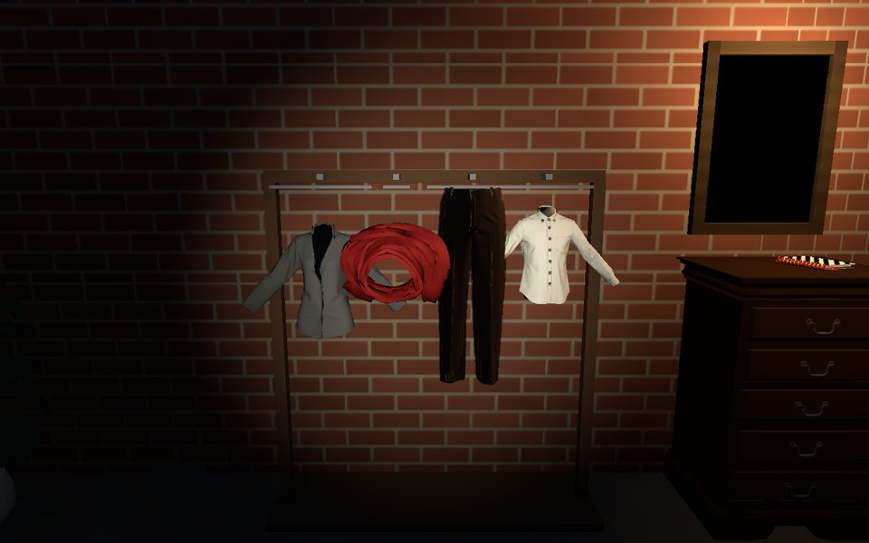
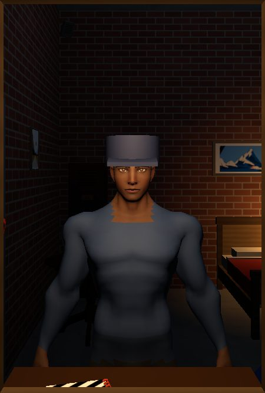
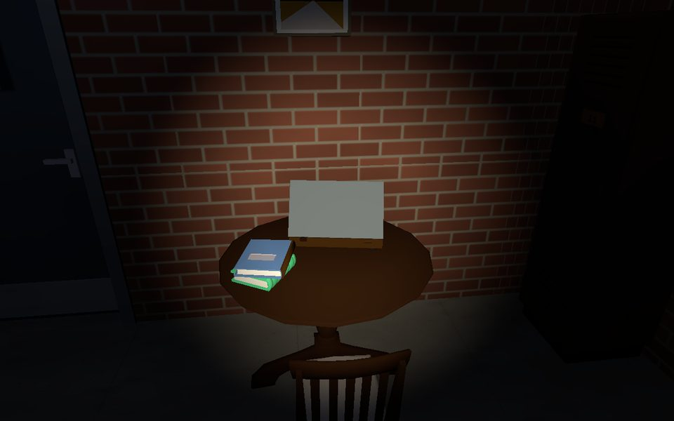

# The Last Shift

A short VR escape room made in Unity for our AR/VR portfolio project at ALU.

You stayed late to return a box of old records and the door locked behind you. Now you're stuck overnight in Records Room B of an old campus archive, and the only way out is to follow the notes left by the night caretaker, Joseph Habimana. Getting out of Room B is only half of it: the door opens onto Room C, which looks the same but isn't quite right. Two rooms, and no timer.

It runs in the browser on a desktop, and in a VR headset through WebXR.

## Links

- Play in the browser (Unity Play): https://play.unity.com/en/games/35f7f4fc-1243-4238-ab2d-726d13f93eb3/the-last-shift
- Code walkthrough video: https://drive.google.com/file/d/1u9mSk9Juq3QTEd3FGefharAuhzUArSFC/view?usp=sharing
- Gameplay in a VR headset: https://youtu.be/aDxJH-bOJoQ
- Gameplay in the browser: https://youtu.be/ovYiqaCMZus
- DevLog: https://docs.google.com/document/d/1GI_zj5g7sMNep82Gk4t9jAgpbX-zGPlQsGtxbJupAW0/edit?usp=sharing

On a headset, open the Unity Play link in the Quest browser and press Enter VR at the bottom right of the game.

If the game is slow or won't load:

- Use Chrome. It ran smoothest for us.
- On a laptop with two graphics chips (Intel and NVIDIA), Chrome may pick the weaker one. In Windows Settings > System > Display > Graphics, set Chrome to High performance and restart Chrome.
- ALU's campus Wi-Fi blocks game sites, Unity Play and itch.io included. Use mobile data or another network.

## Screenshots



The title screen, on a desk in Records Room B.



Room C, Habimana's room. The clothes go back on the rack in the right order, by torchlight.



The cap mirror once you've put on his cap.



The record player on the tea table plays the title tune, muffled like an old record.

## Team

| Member | Role |
|---|---|
| Amanda Leslie Inema (group leader) | Room design and art for Room B and Room C, lighting, the cap mirror, code walkthrough video |
| Brian Gatanazi | XR rig and rig switcher, VR interaction (both hands, padlocks, Force Grab), world-space HUD, VR menu, subtitles and intercom, Habimana's voice lines, keypad screens and lockout, title screen, game look (paper and amber themes), desktop pause menu, Quest build and headset testing |
| Allan Gama Ntare | Items, notes and locks, story and puzzle wiring, settings and autosave |
| Mutabazi Ishimwe Bruno | Project setup and repo, web build and the Unity Play page, end card, clothes puzzle, music, README |

## How to play

On desktop:

| Key | Action |
|---|---|
| WASD + mouse | Move and look around |
| E | Use, pick up, open |
| F | Flashlight |
| Tab | Inventory (you can turn items over to examine them) |
| Esc | Pause menu |

In VR (Quest browser):

| Control | Action |
|---|---|
| Left stick | Walk |
| Right stick | Snap turn |
| Trigger (either hand) | Use what the ray points at: open, take, unlock, press keypad keys |
| Grip | Grab clothes and hang them on the hooks |
| X or A | Torch on and off |
| Y or B, or the left menu button | Menu with your items, notes and settings |

Both hands work, so you can play left-handed.

## Accessibility

- Every voice line has a subtitle with the speaker's name. Subtitles can be turned off in the settings.
- There's a text size setting. It changes the subtitles and the HUD, on desktop and in VR.
- No timer. The torch battery drain can be turned off, so the torch never runs out.
- After three wrong codes a keypad locks you out. That can be turned off too.
- Puzzle clues never rely on colour alone. Labels carry a shape and a year, and keys and hooks carry numbers.
- The objective line always tells you what to try next, so it doubles as a hint.
- Notes are short and shown in large, high-contrast text. In VR, text always draws on top of the room, so walls never cut through it.
- For comfort in VR, the edges of the view darken while you move or turn, turning is snap turn instead of smooth, and the walking speed is kept slow.

## Running the project

1. Install **Unity 6000.4.7f1** with WebGL Build Support. Add Android Build Support too if you want to build for Quest.
2. Clone this repo.
3. Download **Escape Puzzle Kit Free 1.1.0** by heyheythere from itch.io (https://heyheythere.itch.io). It isn't in this repo because its licence doesn't allow sharing its files.
4. Open the project in Unity Hub (Add > Add project from disk). If Unity offers to enter Safe Mode because the kit is missing, choose Ignore.
5. Import the kit: Assets > Import Package > Custom Package, pick `escape-puzzle-kit-free-1.1.0.unitypackage` and import everything. It goes into `Assets/EscapePuzzleKitFree/`.
6. Open `Assets/_LastShift/Scenes/Title.unity` and press Play. To skip the menu while testing, open `RecordsRoomB.unity` instead.

## Web build

We publish on Unity Play.

1. File > Build Profiles, pick Web, set Code Optimization to Runtime Speed and click Build. Choose an empty folder outside the repo.
2. Sign in to Unity (Unity Hub has to be open), then click Publish to Play. If it says no build was found, use Locate Build and pick the folder from step 1.
3. Pick Update existing game for a new version, so the link stays the same. New game makes a new page.
4. On the Unity Play page that opens, set the title and description, set it to Public and save.

To try a build on your own computer first, it has to come from a web server: opening `index.html` straight from the folder only gives "Script error". In the build folder run `python -m http.server 8000` and open http://localhost:8000.

The project is set to Gzip compression with decompression fallback, so the build loads on any host without special server settings. If you change it back to Brotli the page stays stuck on a blank screen.

For VR in the browser, two settings have to stay on: WebXR Export ticked on the WebGL tab of XR Plug-in Management, and the WebXRFullView2020 page template (in `Assets/WebGLTemplates/`) picked in Player Settings, because that page has the Enter VR button. Without either one the game still loads, but a headset can't get into VR.

For the build you publish, set Code Optimization to Runtime Speed in Build Profiles > Web. "Shorter Build Time" builds faster but the game runs noticeably slower in the browser. The music loads each track only when it's needed and is mono, because a browser decodes every clip in full, and the first voice line has to wait for that.

Saves live in the browser, so they survive a page reload.

## Project layout

```
Assets/
  _LastShift/            everything we made
    Scenes/  Prefabs/  Scripts/  Items/  Art/  Audio/
  EscapePuzzleKitFree/   the kit, imported locally, not tracked by git
  Settings/              URP settings
  WebGLTemplates/        the web page with the Enter VR button
Media/                   screenshots for this README
```

## Working on the project

- Don't edit anything inside `EscapePuzzleKitFree/`. If you need to change a kit prefab, make a prefab variant and save it in `_LastShift/Prefabs/`.
- Everyone uses the same kit version (1.1.0). Our prefabs point at the kit's files by their IDs, so a different version can break them.
- Work on your own branch and open a pull request into `main`. Keep `main` in a state that opens and plays.
- Only one person edits a scene at a time. Unity scene files don't merge well, so say in the group chat before you change `RecordsRoomB.unity` or `RoomC.unity`.

## End card

When the player opens the way out, the game moves to `EndCard.unity`, which shows their time, the credits, and Play again and Quit buttons. For this to happen, the exit door's Door component needs `endsGame` ticked. Nothing else has to go in the room scene, because `EndCardLoader` picks up the kit's escape event by itself.

Play again starts a fresh run (no items, flags or saved state). On the web build, Quit shows a "you can close this tab" line, since a web page can't close its own tab.

## Clothes puzzle (Room C)

The player re-hangs the caretaker's clothes on the rack in the right order and puts on his cap. It works the same on desktop and in VR:

- Desktop, or the VR pointer: use a piece to pick it up, then use a hook to hang it. Using a hook that already has something on it swaps the two. Use the cap to put it on.
- VR hands: grab a piece with grip and let go with the top of the hanger at a hook, and it snaps on. Lift the cap to your head to wear it.

The prefabs are in `Prefabs/Clothes/`: `ClothesRack` (four hooks and the puzzle), `Coat`, `Shirt`, `Scarf` and `Cap`. These prefabs use simple placeholder shapes. In Room C the coat, shirt and trousers are Gama's variants of them, dressed in proper garment models. To set it up in a scene:

1. Drop in `ClothesRack`, the clothes and the cap. Keep the clothes away from the hooks at the start.
2. On each hook, set `answer` to the piece that belongs there. Leave it empty for a hook that should stay empty.
3. Every piece needs its own `pieceId`, because saves use it.

When every piece is on the right hook, the puzzle sets the flag `clothes_solved` and locks the rack. Wearing the cap is a separate step that sets `cap_worn`, and the exit in Room C waits for both. The cap can't be taken until `clothes_solved` is set (its `lockedUntil` field), so nobody can grab it through the side of the locked wardrobe. If you want the rack itself to wait for the cap, tick `needsCap` on the rack and clear `lockedUntil` on the cap. `Scenes/Sandbox/Bruno.unity` has a working setup to try it in.

## Music

The title plays a slow music box tune. Both rooms have a low drone with no tune, so it never covers Habimana's voice, and in Room C the drone is a little lower and the same music box tune plays from the caretaker's record player. When the exit opens the drone fades into birdsong, which carries on through the end card. All the music dips while Habimana is talking.

`MusicPlayer` creates itself and picks the tracks by scene name, so nothing has to be placed in a scene. Scenes outside the game, like the sandboxes, stay silent. The tracks and their volumes are in `Audio/Music/Resources/MusicSet.asset`. `RecordPlayer.wav` is the menu tune made to sound like an old record (muffled, mono, with crackle), done as a file because web builds skip Unity's audio filters.

## What came from the kit and what we built

**From Escape Puzzle Kit Free:** the interaction, inventory, doors and locks systems, story beats and saves, the HUD, the prop and set piece models, and the sounds.

**Built by us:**

- Both rooms: the layout, lighting, labels and signs, textures, and Room C as Habimana's bedroom with the cap mirror
- The story, notes and codes, the items and what's in each container, and the story beats that tie them together
- The clothes puzzle, the end card and the music
- The intercom with Habimana's voice lines and subtitles, the keypad screens and the three-try lockout
- The title screen, the desktop pause menu, the VR menu and the settings menu, including the battery and lockout toggles
- Autosave, and the Continue button on the title screen
- The rig switcher, VR interaction with both hands, the world-space HUD and the VR comfort settings (vignette, snap turn, slow walk)
- The character in the cap mirror
- The web page with the Enter VR button, and the Quest build

## Credits

- Escape Puzzle Kit Free and PSX Horror SFX by heyheythere (https://heyheythere.itch.io), used under the kit's licence.
- "If a Music Box Could Speak" by tyufyakin (https://pixabay.com/music/solo-piano-if-a-music-box-could-speak-455948/), the title tune and the record player.
- "Ambient Horror" by leberch (https://pixabay.com/music/ambient-ambient-horror-518292/), the drone in both rooms.
- "Birds chirping at dawn" by dbsound (https://pixabay.com/sound-effects/nature-birds-chirping-at-dawn-246036/), the dawn.
- The three Pixabay tracks are used under the Pixabay Content License.
- WebXR Export by De-Panther (https://github.com/De-Panther/unity-webxr-export), which runs VR in the browser. The web page with the Enter VR button is its WebXRFullView2020 template, with the AR button hidden.
- The character in Habimana's mirror is from Universal Base Characters by Quaternius (https://quaternius.com/packs/universalbasecharacters.html), CC0. We painted his shirt and trousers onto the skin texture and gave him the buzzed hair from the same pack.
